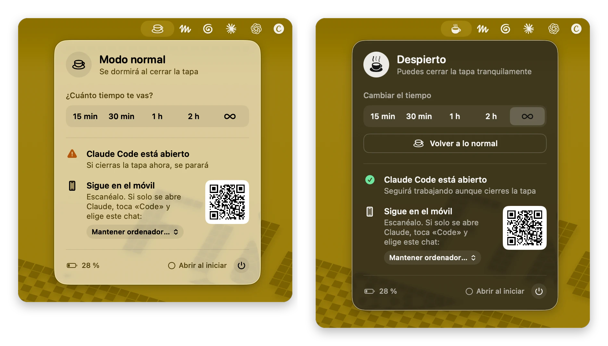

<p align="center">
  
</p>

<h1 align="center">Despierto ☕</h1>

<p align="center">
  <b>Vete a por un café. Tu Mac (y tu IA) siguen trabajando.</b><br>
  Una mini app para la barra de menú de macOS que mantiene tu Mac encendido aunque cierres la tapa.
</p>

<p align="center">
  <a href="https://github.com/laulys/despierto/releases/latest/download/Despierto.zip"></a>
  <br><sub>macOS 13 o posterior · Apple Silicon e Intel · <a href="#instalación">cómo instalarla</a></sub>
</p>

<p align="center">
  
  <br><sub>Animación dibujada por la propia app (el fondo de escritorio es simulado).</sub>
</p>

## ¿Para qué?

Estás vibecodeando con **Claude Code**, **Codex** o **Cursor**, te apetece un café y cierras el portátil… y la sesión se corta. 😩

Con Despierto eliges cuánto tiempo te vas, cierras la tapa y todo sigue funcionando. Y si quieres, **continúas el chat desde el móvil**.

## Qué hace

- **☕ Pausa café**: elige 15 min, 30 min, 1 h, 2 h o sin límite. Cuando se acaba el tiempo, el Mac vuelve solo a lo normal, aunque la tapa siga cerrada.
- **⏱ Cuenta atrás en la barra de menú**, para que sepas cuánto te queda.
- **🤖 Vigila Claude Code**: si está abierto y no has activado Despierto, te avisa de que se parará si cierras la tapa.
- **📱 Sigue en el móvil**: un código QR para abrir Claude en el móvil y continuar tus sesiones de Claude Code.
- **🔋 Batería a la vista**, con aviso si vas con poca y sin cargador. Y si baja del **10 %** sin cargador, Despierto vuelve solo a lo normal para que el Mac pueda dormirse y no se apague de golpe, aunque hayas cerrado la app.
- **🪟 Cristal transparente**: claro en modo normal y ahumado en negro ceniza cuando está activado. Funciona en modo claro y oscuro.
- **✨ Animado con calma**: al activarlo, la taza se llena y el vapor se dibuja y sube en bucle. Respeta «Reducir movimiento» de macOS.
- Opción de **abrirse al iniciar sesión**.

<p align="center">
  
</p>

| Icono arriba | Qué significa |
|---|---|
| Taza vacía | Normal: el Mac se duerme al cerrar la tapa |
| Taza humeante | Despierto: puedes cerrar la tapa |
| Taza humeante + 18:24 | Pausa café: tiempo que queda |

## Instalación

Funciona en macOS 13 o posterior, en Mac con Apple Silicon o Intel.

### Opción 1 · Una línea en la terminal (recomendada)

```bash
curl -fsSL https://raw.githubusercontent.com/laulys/despierto/main/install.sh | bash
```

Descarga la última versión, comprueba que es exactamente la publicada (SHA-256), la copia a **Aplicaciones** y la abre. Si el archivo no coincide, no instala nada.

La app no está firmada ni revisada por Apple, y al instalarla así macOS no te avisa de ello. [Lee el script](install.sh) antes (es corto) o [compílala tú](#opción-3--compilarla-tú).

### Opción 2 · Descargar

1. Pulsa **[Descargar para macOS](https://github.com/laulys/despierto/releases/latest/download/Despierto.zip)** y descomprime el zip.
2. Arrastra **Despierto** a tu carpeta **Aplicaciones**.
3. Ábrela. La app no está firmada por Apple, así que la primera vez macOS dirá que no puede verificarla. Pulsa **Hecho**, ve a **Ajustes del Sistema → Privacidad y seguridad**, baja hasta el aviso de Despierto y pulsa **Abrir igualmente**. Solo hace falta una vez.

### Opción 3 · Compilarla tú

Necesitas las herramientas de Xcode (`xcode-select --install`).

```bash
git clone https://github.com/laulys/despierto.git
cd despierto
./build.sh
open build/Despierto.app
```

Si la vas a usar a diario, marca **«Abrir al iniciar»** en el panel.

## Seguir el chat en el móvil 📱

Usa **Remote Control** de Claude Code: tus sesiones del Mac aparecen en la app de Claude del móvil (o en [claude.ai/code](https://claude.ai/code)) y puedes seguir escribiendo desde ahí.

- **En la app de escritorio de Claude**: activa *Settings → Claude Code → Connect new sessions to Remote Control*.
- **En la terminal**: escribe `/remote-control` dentro de una sesión (el panel tiene un botón para copiarlo) o empieza con `claude --remote-control`.

El QR de Despierto lleva al chat que está trabajando (o al más reciente). Si tienes varios conectados, pulsa su nombre para elegir otro.

> **Si el móvil solo abre la app de Claude:** es un fallo conocido de la app con los enlaces de Remote Control (también pasa con el QR oficial de Claude Code). Entra en la pestaña **Code** y elige el chat con el nombre que muestra Despierto.

El Mac tiene que seguir encendido para que la sesión funcione. Para eso está Despierto. 😉

## Cómo funciona

Por debajo usa el comando de macOS:

```bash
sudo pmset -a disablesleep 1   # no dormir al cerrar la tapa
sudo pmset -a disablesleep 0   # volver a lo normal
```

Como es un ajuste del sistema, **la primera vez** macOS te pide tu contraseña. Con ella, Despierto instala un permiso que **solo** sirve para esos dos comandos (`pmset -a disablesleep 0` y `1`) y lo comprueba con `visudo` antes de guardarlo. Después ya no te la vuelve a pedir, ni siquiera para el temporizador. La app nunca ve ni guarda tu contraseña: la pide el propio sistema.

El permiso es para tu usuario, así que otros programas tuyos también podrían usar esos dos comandos (y nada más). Puedes quitarlo cuando quieras: mira [Desinstalar](#desinstalar).

Mientras está activado, un pequeño proceso vigila por detrás. Funciona aunque cierres la tapa o salgas de la app, y vuelve a lo normal cuando:

- se acaba la pausa café,
- la batería baja del 10 % sin cargador,
- apagas o reinicias el Mac, o cierras sesión.

Si ese proceso desaparece (por ejemplo, el Mac se apaga de golpe), hay una red de seguridad: al iniciar sesión y cada minuto, macOS comprueba si Despierto dejó el Mac despierto sin vigilante y lo devuelve a lo normal, aunque la app esté cerrada. Se añade la primera vez que lo activas (macOS te avisa de que hay un nuevo elemento en segundo plano). No toca nada si lo activó otro programa.

Todo el código está en [`main.swift`](main.swift), con comentarios en español. El icono se dibuja con [`icon.swift`](icon.swift).

## ⚠️ Ojo

- **No metas el Mac en la mochila** con el modo despierto activado: se puede calentar mucho.
- Con la tapa cerrada sigue gastando batería, así que mejor enchufado. Si baja del 10 % sin cargador, vuelve solo a lo normal, aunque la app esté cerrada.
- Si eliges **∞ (sin límite)**, acuérdate de volver a lo normal.

## Desinstalar

1. En el panel, pulsa **···** → **Volver a lo normal y quitar permisos…** y escribe tu contraseña. También deja de abrirse al iniciar sesión.
2. Pulsa el botón de apagado para salir.
3. Borra **Despierto** de Aplicaciones.

¿Ya borraste la app? Hazlo desde la terminal:

```bash
sudo pmset -a disablesleep 0
```

```bash
sudo rm /etc/sudoers.d/despierto
```

## Seguridad

¿Has encontrado un fallo de seguridad? Mira [SECURITY.md](SECURITY.md).

## Publicar una versión nueva

```bash
./release.sh
gh release create vX.Y.0 build/release/Despierto.zip --title "Despierto X.Y.0"
git commit -am "install.sh: vX.Y.0" && git push
```

`release.sh` compila la app para Apple Silicon e Intel y la empaqueta en un zip. También apunta en `install.sh` la versión y su huella SHA-256, por eso se sube después de publicar. El botón de descarga baja siempre la última versión.
